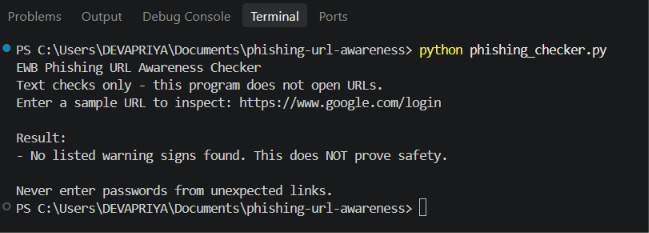
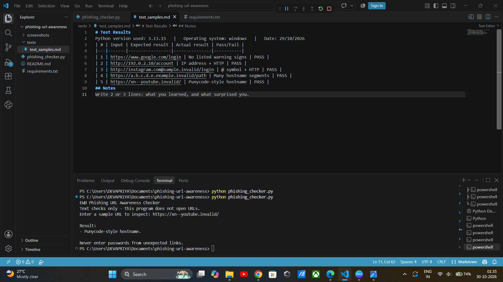

# EWB Phishing URL Awareness Checker
# Overview

Phishing is a type of social engineering attack that tricks victims into revealing sensitive information through emails and malicious links.

The Phishing URL Awareness Checker is a Python-based educational tool that helps users identify suspicious elements in URLs.

## Features
- Detects an @ symbol in the URL
- Flags unusually long URLs (over 100 characters)
- Flags IP-address hostnames
- Flags many hostname segments (5 or more)
- Flags punycode-style hostnames (xn--)
- Flags the HTTP scheme
- Supports continuous URL checking until the user enters 'q'.
- Displays a warning summary when suspicious indicators are detected.
- Handles malformed URL input without crashing.

## Requirements
Python 3.10 or later. No extra packages.

## How to Run
Windows:   python phishing_checker.py
Mac/Linux: python3 phishing_checker.py

## Example Output
Enter a sample URL (or type q to quit):
https://www.google.com/login

Result:
- No listed warning signs found.
This does NOT prove safety.

## Testing
| # | Input | Expected | Actual | Result |
|---|-------|----------|--------|--------|
| 1 | https://www.google.com/login | No listed warning signs | No warning signs found | [PASS] |
| 2 |  http://192.0.2.10/account | HTTP and IP warnings | both warnings displayed | [PASS]
| 3 | http://[bad  | Invalid URL message | Invalid URL message | [PASS] 
| 4 | http://instagram.com@sample.invalid/login  | HTTP and @ warnings | both warnings displayed [PASS] 
| 5 | https://a.b.c.d.e.example.invalid/path  | Many hostname segments warning |Warning displayed [PASS] 
| 6 |  https://xn--youtube.invalid/ | Punycode warning | Warnings displayed [PASS] 

## Screenshots

## Improvements
1. Continuous URL Checking – Modified the program to accept multiple URLs without restarting it. Tested by entering multiple URLs and exiting using q.
2. Warning Summary – Added a warning count and a REVIEW CAREFULLY message when suspicious indicators are detected. Tested using URLs with multiple warning signs.
3. Invalid URL Handling – Added URL validation to handle malformed URL inputs without crashing. Tested using http://[bad.

## Limitations
This is an educational tool. It only reads URL text. It does not visit
URLs, scan for malware or prove that a URL is safe. No warning signs
found does NOT mean a URL is safe.

## Ethical Use
Use sample strings only. Do not collect credentials. Do not use this
project to deceive anyone or to test websites without permission.

## Author
Devapriya, AI-Powered Cybersecurity, EWB Courses